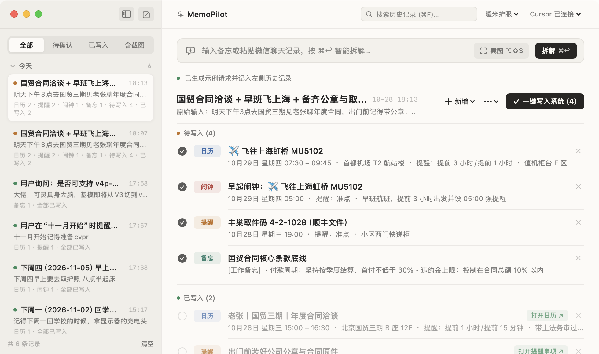
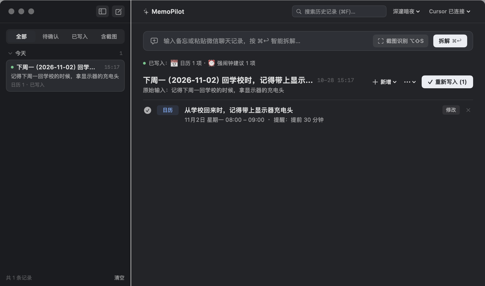

# MemoPilot 闪记领航


一款本地优先的 macOS 原生 AI 日程与备忘中枢，使用 Swift 6、SwiftUI、EventKit、Vision 与 Carbon 构建（支持 macOS 15+，通过 iCloud 自动同步至 iPhone）。

## 亮点预览

### 1. 自然语言与微信截图一键拆解（日历 · 提醒 · 闹钟 · 备忘）
随手输入一段碎碎念，或按 `⌥⇧S` 框选微信聊天记录、会议海报、航班与取件码截图，AI 自动提取时间与地点，智能推算提前提醒时长（如早班航班自动提前 3 小时提醒并生成独立早起闹钟），支持在悬浮气泡中自由修改或一键切换目标类型（`日历` / `提醒` / `闹钟` / `备忘`）。



### 2. 原生备忘录工作台与四色护眼主题
采用 macOS 原生「备忘录」风格的双栏纸面设计，支持左侧历史记录按「已置顶 / 今天 / 更早」折叠归档、全文检索与四维过滤（全部 / 待确认 / 已写入 / 含截图），内置 **暖米护眼、纯净纸白、冰川雾蓝、深邃暗夜** 四套主题，同时提供常驻顶部菜单栏极速入口。



## 下载与安装

- **直接下载安装包（Apple Silicon / M 系列芯片）**：[**MemoPilot-macOS-arm64.zip**](https://github.com/Mukayi/memopilot/raw/main/Releases/MemoPilot-macOS-arm64.zip)
- 解压后将 `MemoPilot.app` 拖入 `/Applications`（应用程序）即可。
- *注：应用使用本地开源构建（未绑定付费 Apple 开发者公证），首次打开若提示无法验证开发者，请在「系统设置 → 隐私与安全性」中点击“仍要打开”，或在终端执行 `xattr -cr /Applications/MemoPilot.app`。*

## 核心功能

- **多模态输入与离线 OCR**：支持随手输入文本、粘贴微信聊天记录，或按全局快捷键 `⌥⇧S` 交互式框选屏幕区域（内置 Apple `Vision` 高精度中文离线 OCR 加速识别）。
- **智能推算提前提醒量**：根据事件性质自动设置多重提前提醒（如线上会议提前 15m/5m、线下赴约提前 60m/15m、高铁/航班提前 3h/1h，清早刚性日程自动生成独立强闹钟）。
- **草稿自由编辑与类型互转**：写入前可点击任意草稿或「修改」按钮唤出原生毛玻璃气泡，随时在 **日历、提醒、闹钟、备忘** 四种类型间一键互转，微调起止时间、提前提醒胶囊与地点备注。
- **零额外 API 充值成本**：支持直接复用本机已登录的 **Cursor Agent** 通道或 **OpenAI 付费账号（Codex CLI）**，开箱即用。
- **Apple 原生生态无缝同步**：通过 `EventKit` 与 AppleScript 直接写入 macOS 系统「日历」「提醒事项」与「备忘录」，借助 iCloud 秒级同步至 iPhone / Apple Watch；配套提供 [iPhone 快捷指令联动手册](docs/IPHONE_SHORTCUT_GUIDE.md)。
- **全量历史本地持久化**：自动归档每次请求的原始文本、关联截图与拆解状态，所有数据仅保存在本机 `~/Library/Application Support/MemoPilot/`。

## 快捷键

- `⌥Space`：随处呼出或隐藏 MemoPilot 主工作台窗口
- `⌥⇧S`：一键框选微信 / 屏幕区域截图并自动识别拆解
- `⌘↩`：执行 AI 智能拆解
- `⌘N`：新建备忘输入
- `⌘F`：聚焦历史记录搜索框
- `⌃⌘S`：隐藏或展开左侧历史侧边栏

## 从源码构建

```sh
# 在 Xcode 中打开
open -a Xcode Package.swift

# 或直接运行测试并打包本地 .app 与 Release 安装包
swift test
./scripts/build_app.sh
open dist/MemoPilot.app
```

## 开源协议

- 源代码基于 [MIT License](LICENSE) 开源。
